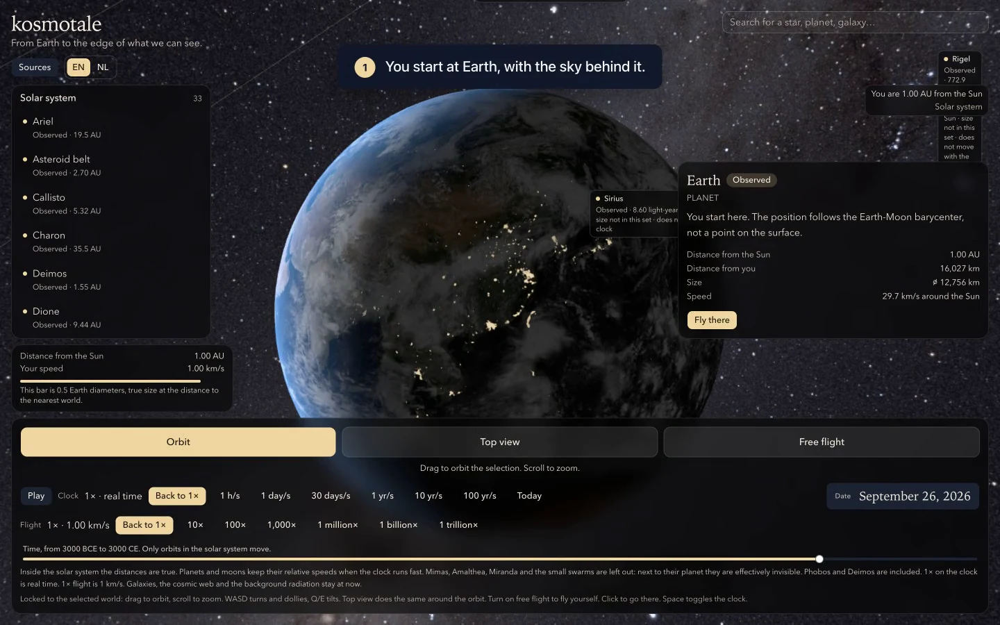

# kosmotale

[](https://pesuto.dev/work/kosmotale/)

A small web app for flying through the universe: from Earth to the edge of what we can see. This is a hobby project. No accounts, no database, no API keys.

The case study and the 36-second tour — Earth, top view, the year 2000, then the flight to Sirius — are on [pesuto.dev](https://pesuto.dev/work/kosmotale/) ([Dutch](https://pesuto.dev/nl/work/kosmotale/)). A live copy of the app itself is not online yet.

## License

- **Code:** [Apache License 2.0](LICENSE). That is the open-source license for the program.
- **Star data** (`data/stars.json`): a derivative of the [Hipparcos](https://www.cosmos.esa.int/web/hipparcos) catalogue. This file is [Creative Commons Attribution-NonCommercial 3.0 IGO](LICENSES/hipparcos.txt), including for anyone who receives a copy. Do not use it commercially, do not imply ESA endorsement, and do not relabel it as Apache. See `LICENSES/hipparcos.txt` and `NOTICE`.
- **Sky image** (`public/textures/sterren.jpg`): a 4096×2048 sRGB JPEG of [NASA SVS 4851, Deep Star Maps 2020](https://svs.gsfc.nasa.gov/4851) (`starmap_2020_4k.exr`), without constellation figures. The pixels include Hipparcos-2, Tycho-2 and Gaia DR2. Those Hipparcos and Tycho stars cannot be separated, so this file is [CC BY-NC 3.0 IGO](LICENSES/sterrenkaart.txt), not NASA public domain and not Apache. Credit NASA/Goddard SVS and ESA/Gaia/DPAC. A free copy, including on your own website, is allowed. Do not earn money from the image. See `LICENSES/sterrenkaart.txt` and `NOTICE`.

The code can be reused under Apache-2.0. The catalogue and the sky image cannot. The distribution as a whole is therefore not Apache-2.0, and is not fully open source. The still at the top of this README is a frame of the app, so the same sky-image terms apply to it.

## Run locally

You need Node.js 20 or newer.

```bash
npm install
npm run dev
```

Then open [http://localhost:43127](http://localhost:43127). The dev server listens on port **43127**.

- `npm test` checks Kepler, IAU rotation and scale compression.
- `npm run build` writes a static site to `out/` and copies `LICENSE`, `NOTICE`, `LICENSES/hipparcos.txt` and `LICENSES/sterrenkaart.txt` there from those source files.
- `npm run check:export` verifies that those copies match and that the CC URI and links are present in the export.
- `npm start` then serves `out/` on port 43127, using Python's `http.server` (`python3` on `PATH`).
- `npm run lint` and `npm run typecheck` are also in the tree. CI on Node 22 runs those, the tests, the build and the export check.

There is no live deploy in this repository. The pages on pesuto.dev come from the [pesuto](https://github.com/pesuto-dev/pesuto) site.

## Static hosting

The export has no subpath by default. `NEXT_PUBLIC_BASE_PATH` is empty until the host has a real subpath; that value becomes `basePath` and the prefix for textures and license links. The files themselves stay at the root of `out/`, next to `index.html`.

## Language

The interface is English by default. NL in the header switches to Dutch. `?lang=en` or `?lang=nl` sets it for that visit and remembers the choice.

## Controls

- Orbit keeps the camera on the selected world: drag to orbit it, scroll to zoom, WASD or the arrow keys to turn and dolly, Q and E to tilt
- Top view (Bovenaanzicht) looks down on that orbit (planets, moons and Pluto). Drag still orbits, scroll still zooms
- Free flight (Los navigeren): drag to look, WASD or the arrow keys to fly, Q and E to go up and down. The scroll wheel then changes flight speed. Shift holds ×10 for a moment
- The three camera modes sit at the top of the control bar
- Date opens a picker: year, month and day, plus Today, J2000, the Apollo 11 landing and Voyager 2 at Neptune. The year slider underneath still scrubs from 3000 BCE to 3000 CE
- Flight and clock have two separate speed controls, each with a button back to 1×
- 1× flight is 1 km/s. Higher is a multiple
- 1× on the clock is real time
- Click an object, or pick it from the list, to fly there. That also turns free flight off
- Space starts and stops the clock
- Sources: the button in the header

## Recording the demo

The film on [the kosmotale case study](https://pesuto.dev/work/kosmotale/) is the demotale scenario in `demo/kosmotale.demo.ts`: Earth, top view, the year 2000, then the flight to Sirius. Run `npx demotale agent-guide` before changing it. With the dev server already on port 43127:

```bash
npx demotale record --headed
```

The take lands in `demo/output/` and is not committed. Headless Chromium draws the Earth and then goes grey, so the recording stays headed.

The older camera script below is a short silent take, not the site film. Record it on a laptop with a real GPU. It opens headed Chromium and does not pass SwiftShader flags.

Prerequisites: Node.js 20 or newer, Chromium for Playwright (`npx playwright install chromium`, once), and ffmpeg on `PATH` (`winget install Gyan.FFmpeg`, `brew install ffmpeg`, or `sudo apt install ffmpeg`).

```bash
npm run record-demo
```

With no `--url`, the script starts `next dev` on port 43127, or reuses that port if a server is already listening. `--prod` runs `next build` and serves the static `out/` folder with Node. This app is `output: "export"`, so `next start` does not serve it.

- `--url http://127.0.0.1:43127` — record a server that is already running
- `--duration 15` — length of the camera path in seconds (default 15, allowed 8–60)
- `--lang en` or `--lang nl` — interface language. English is the default
- `--prod` — record the production export instead of the dev server

The page cursor is hidden (`cursor: none`). The video is 1280×800; the headed window renders at `deviceScaleFactor` 2. Playwright does not capture the OS cursor.

Files in `demo-output/` (gitignored): `kosmotale-demo.mp4` (H.264, yuv420p, faststart, no audio, about 1–3 MB), `kosmotale-demo.webm` (VP9, no audio), and `kosmotale-demo.png` (a poster from the opening Earth shot). If ffmpeg is missing, the script prints the commands and leaves the raw take in `demo-output/raw/`.

The path is fixed. It holds on Earth, drags to orbit, scrolls to zoom out toward the stars, then searches for Sirius and opens its info card. There is no constellation picker; Sirius is the star in the shot.

## Sources

- Planet orbits: E.M. Standish, Keplerian elements, JPL. Diameters: NASA Planetary Fact Sheet.
- Pluto and moons: osculating elements from JPL Horizons at J2000. An approximation, not a full ephemeris.
- Star positions: ESA (1997), *The Hipparcos and Tycho Catalogues*, I/239. Credit: ESA. CC BY-NC 3.0 IGO. The committed subset has 401 labelled stars. See `LICENSES/hipparcos.txt`.
- Background sky: NASA SVS 4851, Deep Star Maps 2020, Hipparcos-2, Tycho-2 and Gaia DR2, no constellation figures. Same CC BY-NC 3.0 IGO, because the Hipparcos and Tycho stars stay in the pixels. Credit: NASA/Goddard Space Flight Center Scientific Visualization Studio. Gaia DR2: ESA/Gaia/DPAC. See `LICENSES/sterrenkaart.txt`. `python3 scripts/build-textures.py sterren` rebuilds the JPEG (Pillow, numpy, OpenEXR).
- Star names: IAU Catalog of Star Names (WGSN). No CC version number claimed.
- Mercury: USGS, MESSENGER MDIS Global Color Mosaic 665 m, edition 3, public domain, cite the authors. The TIFF is not committed. `python3 scripts/build-textures.py mercurius` fetches and scales it.
- Uranus: NASA VTAD, texture from the 3D model.
- Other maps: NASA or NASA-3D-Resources. No NC. No endorsement and no NASA logo.
- Cosmic distances are rounded, commonly cited values. Where it is a model, the UI says so.

`npm run check` remains available alongside `npm test`.
